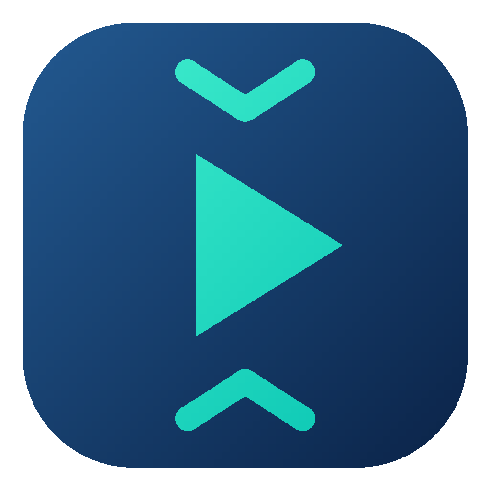
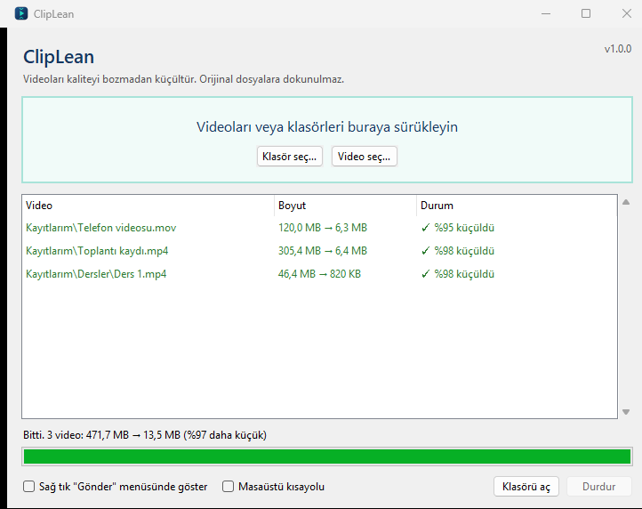

<p align="center"></p>

# ClipLean

Windows için tek tıkla video küçültme aracı. Videoları ya da klasörleri pencereye sürükleyin; ClipLean her videoyu modern **AV1** ve **Opus** formatlarıyla yeniden sıkıştırır. Kalite gözle görülür biçimde düşmez, boyut ciddi oranda küçülür. Ekran kayıtlarında küçülme çoğu zaman %95'in üzerindedir.



## İndirme ve kullanım

1. [Releases](../../releases/latest) sayfasından `ClipLean-x.y.z-windows.zip` dosyasını indirin.
2. Zip'i kalıcı bir klasöre çıkarın (örneğin Belgeler) ve `ClipLean.exe`'yi açın.
3. Videoları ya da klasörleri pencereye sürükleyin.

Kurulum gerekmez; taşınabilir bir uygulamadır. Kaldırmak için klasörü silmeniz yeterli. Videolarınız hiçbir yere gönderilmez, her şey bilgisayarınızda çalışır.

> **"Windows bilgisayarınızı korudu" uyarısı:** Program imzalı olmadığı için ilk açılışta çıkabilir. **Ek bilgi → Yine de çalıştır** ile açılır.

Pencerenin altındaki kutularla ClipLean'i **sağ tık → Gönder** menüsüne ekleyebilir ya da masaüstüne kısayol koyabilirsiniz. Kısayolun üzerine video bırakmak da işe yarar.

## Eski yöntemle karşılaştırma

ClipLean, yıllarca kullandığımız HandBrake + PowerShell betiği düzeninin yerine yazıldı.

| | Eski yöntem (HandBrake betiği) | ClipLean |
|---|---|---|
| Nasıl kullanılır? | Videolar `source` klasörüne konur, betik çalıştırılır | Pencereye sürükle-bırak ya da sağ tık → Gönder |
| Kurulum | HandBrakeCLI, ayar dosyası, sabit klasör yolları | Zip'i açmak yeterli |
| Görüntü formatı | H.264 (2003) | AV1 (2018), aynı kalitede çok daha küçük |
| Ses | 160 kbps, küçük dosyalarda boyutun üçte ikisi | 48 kbps Opus, konuşma ve müzikte fark edilmez |
| Ekran kaydı / kamera görüntüsü | Hepsine aynı ayar | Kendisi ayırt eder, ayarı ona göre seçer |
| Tekrar çalıştırınca | Her şeyi baştan sıkıştırır | Sadece yeni videoları işler |
| İşlem yarıda kalırsa | Bozuk dosya kalabilir | Yarım dosya bırakmaz |
| Sonuç orijinalden büyükse | Büyük dosya kalır | Orijinali aynen kopyalar |
| iPhone videoları (.mov) | Atlanır | Desteklenir |
| İlerleme | Komut satırı çıktısı | İlerleme çubuğu, kalan süre, özet |

### Ölçüm

İki gerçek video üç yöntemle sıkıştırıldı.

**Ekran kaydı:** 6 dk 56 sn, 720p, 305 MB

| | HandBrake varsayılanı | Eski ayar | **ClipLean** |
|---|---|---|---|
| Dosya boyutu | 13,5 MB | 11,5 MB | **6,4 MB** |
| Kalite puanı (VMAF) | 96,7 | 94,6 | **96,5** |
| Süre | 33 sn | 34 sn | 43 sn |

**Telefon videosu:** 4 dk 37 sn, 1080p, 436 MB

| | HandBrake varsayılanı | Eski ayar | **ClipLean** |
|---|---|---|---|
| Dosya boyutu | 137,6 MB | 26,7 MB | **51,2 MB** |
| Kalite puanı (VMAF) | 88,6 | 76,7 | **95,2** |
| Süre | 2 dk 5 sn | 1 dk 37 sn | 1 dk 49 sn |

- **Kalite puanı (VMAF):** Netflix'in geliştirdiği, insan gözünün algısını taklit eden ölçü. 100, orijinalle birebir aynı demektir; 95 ve üzeri, genel kabule göre çoğu izleyicinin orijinalden ayırt edemeyeceği seviyedir.
- **HandBrake varsayılanı:** HandBrake'in hazır "Fast 1080p30" ayarı.
- **Eski ayar:** HandBrake, x264 RF 30, AAC 160 kbps, en fazla 720p (`low_2026` ayar dosyası).
- Ölçüm bilgisayarı: AMD Ryzen 5 5600. Sonuçlar videonun içeriğine göre değişir.

Özetle: ekran kayıtlarında ClipLean, HandBrake varsayılanıyla aynı kalitede **yarısından küçük** dosyalar üretir. Telefon videolarında eski ayardan büyük ama çok daha kaliteli, HandBrake varsayılanından ise hem daha kaliteli hem **üçte bir boyutta** dosyalar üretir.

## Ne yapar?

- **Orijinallere dokunmaz.** Klasör verildiğinde çıktılar yanındaki `Klasör (Küçültülmüş)` klasörüne, tek tek video verildiğinde `Küçültülmüş` alt klasörüne yazılır.
- **Klasör yapısını, fotoğrafları ve diğer dosyaları korur.** Dosya tarihleri de aynen kalır.
- **İşlem sürerken bilgisayar uykuya geçmez.** Düşük öncelikte çalıştığı için bilgisayarı kullanmaya devam edebilirsiniz.
- **Güncellemeleri kendisi kontrol eder.** Açılışta GitHub'a en son sürümü sorar; yeni sürüm varsa pencerede bir bağlantı gösterir. Hiçbir kişisel bilgi gönderilmez.

Desteklenen formatlar: mp4, mov, mkv, webm, avi, wmv, flv, m4v, ts, mts, m2ts, 3gp, mpg.

## Teknik ayrıntılar

- Görüntü: SVT-AV1, 10-bit. Ekran kaydında CRF 48 / preset 9, kamera görüntüsünde CRF 40 / preset 8
- Çözünürlük: kısa kenar ekran kaydında en fazla 720, kamera görüntüsünde en fazla 1080 piksel (dikey videolar da doğru küçülür); en fazla 60 fps
- Ses: Opus 48 kbps stereo
- İçerik tespiti: videonun üç noktasından örnek alınır; kareler arası değişim çok azsa ekran kaydı sayılır

Ayarlar [`cliplean/core.py`](cliplean/core.py) dosyasının başındadır.

AV1; Windows 10/11, güncel tarayıcılar, VLC ve son yıllardaki telefonlarda oynatılır. Çok eski cihazlar desteklemeyebilir.

## Geliştirme

Python 3.12+ ve PATH'te `libsvtav1` ile `libopus` içeren bir ffmpeg gerekir ([gyan.dev](https://www.gyan.dev/ffmpeg/builds/) "full" sürümü uygundur).

```powershell
python -m venv .venv
.venv\Scripts\pip install -r requirements-dev.txt
.venv\Scripts\python -m cliplean                     # pencere
.venv\Scripts\python -m cliplean --konsol <klasör>   # konsol modu
.venv\Scripts\python -m pytest                       # testler
.\build.ps1                                          # dağıtım zip'i (dist\)
```

## Lisans

[GPL-3.0](LICENSE). Video işleme için [FFmpeg](https://ffmpeg.org) kullanılır.
